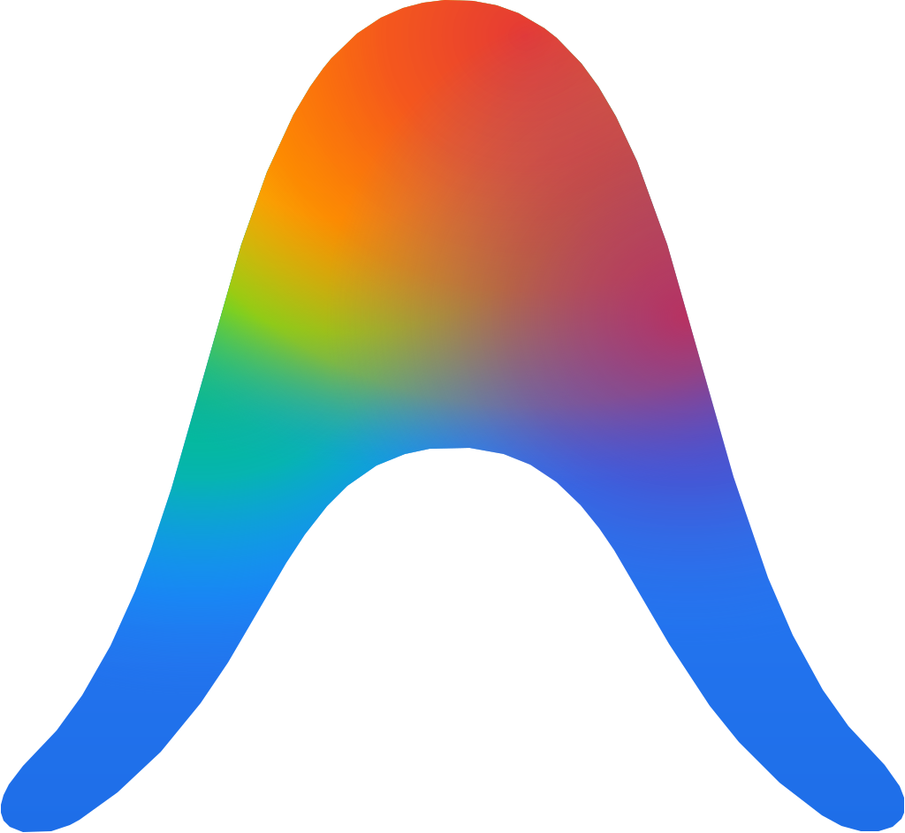

# Antigravity Usage Collector for Omarchy

<p align="center">
  
</p>

An [Omarchy](https://omarchy.org) shell service plugin that automatically collects Google Antigravity (agy) telemetry, token usage by day/model, and quota limits for the desktop Agents bar widget.


## How it works

Omarchy's built-in Agents bar module watches `~/.local/state/omarchy/agents/usage/` and automatically renders any agent data placed there. This plugin runs as a background service in `omarchy-shell`:
* Parses local session transcripts and token usage from Antigravity.
* Periodically fetches Google Gemini / Claude quotas from the Code Assist API.
* Atomically updates `~/.local/state/omarchy/agents/usage/agy.json` every 10 minutes (and on shell startup).
* Survives system updates because it lives in user configuration (`~/.config/omarchy/plugins/`).

## Installation

Run the following command in your terminal:

```bash
omarchy plugin add https://github.com/GaleasAndres/omarchy-antigravity-usage.git --enable
```

### Displaying the Rainbow Logo

Omarchy's Agents panel looks for agent marks in its assets directory. This repository includes the official rainbow Antigravity mark (`assets/agy.svg`).

To install the icon into your Agents panel assets, run:

```bash
~/.config/omarchy/plugins/galeasandres.antigravity-usage/scripts/install-icon
```

*(Or manually copy: `sudo cp assets/agy.svg /usr/share/omarchy/shell/plugins/agents/assets/`)*

## Manual Refresh

You can trigger an immediate refresh over IPC:

```bash
omarchy-shell antigravity refresh
```

Or inspect the service status:

```bash
omarchy-shell antigravity status
```

## License

MIT
